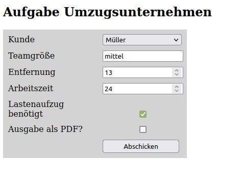
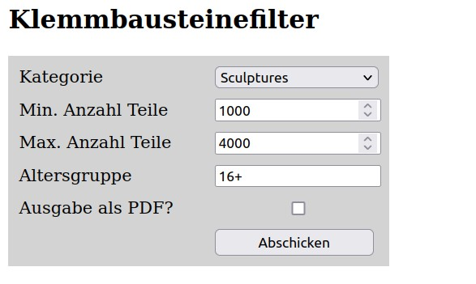

# Kapitel 3: Tabellen, Formulare und Medien

Skript `phpScript.pdf`, Seiten 19–30 · Beispiele: `Vorlesungen/3` · Aufgaben 3.1–3.5 plus zwei Klausur-Formulare (3.6, 3.7)

So gehst du vor: Kopiere zuerst die Beispiele in deinen Workspace (siehe Vorbereitung). Lies dann Teil A bis C mit den Beispieldateien nebeneinander in Eclipse und im Browser und mach die „Selbst ausprobieren“-Schritte. Danach löst du in Teil D die Aufgaben. Lösungen von mir gibt es erst, wenn du deine Dateien abgelegt hast.

**Warum dieses Kapitel wichtig ist:** Jede Probeklausur beginnt mit einem **HTML5-Formular mit Eingabekontrollen** („Stellen Sie client-seitig bereits sicher, dass …“). Das lernst du hier. Teil B ist der wichtigste Teil des Kapitels, Tabellen und Medien sind kürzer.

---

## Vorbereitung

1. Lege in Eclipse im Projekt `IKSY1` den Ordner `Kapitel3/` an, darin `Vorlesungsmaterialien/` und `Loesungen/` (wie bei `Kapitel1_2/`).
2. Kopiere aus dem Kursordner `Vorlesungen/3/` die Dateien `beispiel.html`, `tabellen.html`, `formulare.html`, `medien.html`, `auswertung.php`, `style.css` und die drei `HTML5_logo*.png` nach `Kapitel3/Vorlesungsmaterialien/`.
   - Die Audio- und Videodateien (`Kalimba.mp3` ist 8 MB groß, dazu `horse.ogg`, `film.mp4`, `film.ogv`) kannst du auch kopieren, damit `medien.html` funktioniert. Committe sie aber **nicht** ins Repo (große Binärdateien gehören nicht in Git). Am einfachsten: in Eclipse beim Commit einfach nicht anhaken, oder in die `.gitignore` die Zeilen `*.mp3`, `*.mp4`, `*.ogg`, `*.ogv` aufnehmen.
3. `style.css` verweist auf `../css/background.JPG`. Das Bild liegt bei dir in `IKSY1/css/`, von `Kapitel3/Vorlesungsmaterialien/` aus also zwei Ebenen höher: `../../css/background.JPG`. Passe die Zeile in **deiner Kopie** an, sonst fehlt das Banner-Bild.
4. Aufrufen im Browser: `http://localhost/iks/Kapitel3/Vorlesungsmaterialien/tabellen.html` usw.

---

## Teil A: Tabellen (S. 19–22)

Tabellen sind **nur für tabellarische Daten** da (Stundenplan, Umsätze, später: Ergebnisse aus der Datenbank). Früher hat man ganze Seitenlayouts mit Tabellen gebaut; das macht man nicht mehr, Layout ist Sache von CSS.

> **Klausurbezug:** In den Probeklausuren wird die Ausgabe (Smarty-Template und PDF) fast immer als **Tabelle** dargestellt, z. B. Kundendaten oben, Kostenaufstellung darunter. Die Tabellen-Tags brauchst du also ab Kapitel 7 ständig.

### A.1 Aufbau (Beispiel 3.1, `tabellen.html`)

```html
<table>
    <caption>Umsätze der Kunden</caption>
    <thead>
        <tr>
            <th></th>
            <th>R. Rastlos</th>
            <th>H. Hirsch</th>
        </tr>
    </thead>
    <tbody>
        <tr>
            <th>2019</th>
            <td>1265,67 €</td>
            <td>3427,22 €</td>
        </tr>
    </tbody>
    <tfoot>
        <tr>
            <th>Summe</th>
            <td>4722,61 €</td>
            <td>7263,70 €</td>
        </tr>
    </tfoot>
</table>
```

| Element | Bedeutung | Merkhilfe |
|---|---|---|
| `table` | die Tabelle | |
| `caption` | Tabellenüberschrift, steht **direkt** nach `<table>` | |
| `thead` / `tbody` / `tfoot` | Kopf, Körper, Fuß (gruppieren Zeilen) | Fuß = Summenzeile |
| `tr` | eine Zeile | *table row* |
| `th` | Kopfzelle (fett, zentriert) | *table header*, geht als Spalten- **und** Zeilenkopf |
| `td` | normale Datenzelle | *table data* |

Die Tabelle wird **zeilenweise** aufgebaut: erst `tr`, darin die Zellen von links nach rechts. Jede Zeile muss gleich viele Zellen haben, sonst „fransen“ die Spalten aus. Eine leere Ecke oben links ist einfach ein leeres `<th></th>`.

### A.2 Zellen verbinden: `colspan` und `rowspan` (nicht im Skript, aber für den Stundenplan nötig)

Eine Vorlesung dauert oft zwei Blöcke, oder ein Feld soll über mehrere Spalten gehen:

```html
<tr>
    <th>08:00</th>
    <td rowspan="2">IKS 1</td>     <!-- geht über diese UND die nächste Zeile -->
    <td colspan="2">Mathe</td>     <!-- belegt 2 Spalten nebeneinander -->
</tr>
<tr>
    <th>10:00</th>
    <!-- hier KEINE Zelle für IKS 1, die ist schon von oben belegt -->
    <td>BWL</td>
    <td>Recht</td>
</tr>
```

Die Regel: Eine Zelle mit `rowspan="2"` „frisst“ in der **nächsten** Zeile einen Platz. Dort lässt du die Zelle weg. Mit `colspan="2"` schreibst du in derselben Zeile eine Zelle weniger.

> **Selbst ausprobieren:** Gib in deiner Kopie von `tabellen.html` der Zelle `1265,67 €` ein `rowspan="2"` und lade neu. Die Zeile 2020 bekommt eine Zelle zu viel und ragt rechts heraus. Lösche dann in der Zeile 2020 die erste `td`, und die Tabelle ist wieder gerade.

### A.3 Tabellen-CSS aus `style.css`

```css
table {
    border-collapse: collapse;   /* Rahmen benachbarter Zellen fallen zu EINER Linie zusammen */
    margin: 10px auto;           /* 10px oben/unten, links/rechts "auto" = zentriert */
}
table caption {
    padding: 2px;
    font-size: 110%;
    letter-spacing: 0.2em;       /* gesperrt: Buchstabenabstand 1/5 eines "m" */
    font-variant: small-caps;    /* Kapitälchen */
}
td, th {                         /* Komma = beide Selektoren bekommen die Regel */
    width: 10em;                 /* sonst macht der Browser die Spalten so schmal wie möglich */
    border: 1px solid;
}
```

Ohne Rahmen-CSS hat eine HTML-Tabelle **gar keine Linien**. `margin: … auto` zum Zentrieren klappt, weil `table` ein Block-Element ist.

> **Selbst ausprobieren:** Kommentiere `border-collapse: collapse;` aus (`/* … */`) und sieh dir die doppelten Linien an. Füge dann `th { background-color: #DDDDDD; }` hinzu.

Zwei Dinge, die du für eigene Tabellen oft brauchst:

```css
td { text-align: right; }                      /* Zahlen/Beträge rechtsbündig */
tbody tr:nth-child(even) { background: #F4F4F4; }   /* jede zweite Zeile grau ("Zebra") */
```

---

## Teil B: Formulare (S. 22–27), der klausurrelevante Teil

Ein Formular sammelt Eingaben und schickt sie an ein **Programm auf dem Server**. In unserem Kurs ist das immer ein PHP-Skript. In der Klausur heißt das: `index.php` zeigt das Formular (über Smarty), ein zweites Skript wertet aus.

### B.1 Das `form`-Element

```html
<form method="post" action="auswertung.php">
    ... Eingabefelder ...
    <button type="submit">Eintragen</button>
    <button type="reset">Zurücksetzen</button>
</form>
```

- **`action`**: an welche Datei die Daten geschickt werden. Fehlt `action`, geht es an dieselbe Seite.
- **`method`**: `get` hängt die Daten sichtbar an die URL (`auswertung.php?name=Blümel&zeit=14`), `post` schickt sie im Inhalt der Anfrage. **Nimm immer `post`** (so machen es auch alle Musterlösungen). Im PHP-Skript landen die Daten dann im Array `$_POST`.
- **`button type="submit"`** schickt ab, **`type="reset"`** setzt auf die Anfangswerte zurück. Die Beschriftung ist der Inhalt des Buttons.

### B.2 Was beim Server ankommt: `auswertung.php`

```php
<?php
    print_r($_POST);
?>
```

`print_r` gibt ein Array lesbar aus. Damit siehst du **genau**, was dein Formular abschickt. Das ist dein wichtigstes Werkzeug in diesem Kapitel. Tipp: Mit `echo '<pre>'; print_r($_POST); echo '</pre>';` wird jedes Feld in einer eigenen Zeile angezeigt.

Beispielausgabe für `formulare.html`:

```
Array
(
    [name] => Blümel
    [passwort] => geheim
    [anrede] => anrede_f
    [zeit] => 14
    [datum] => 2026-10-29
    [farbe] => #ff0000
    [bundesland] => Niedersachsen
    [land] => Spanien
)
```

Die **Schlüssel** sind die `name`-Attribute, die **Werte** sind die Eingaben bzw. die `value`-Attribute. Daraus folgen die drei wichtigsten Regeln für Formulare:

1. **Ein Feld ohne `name` wird nicht übertragen.** (`id` reicht nicht!)
2. **Bei Radiobuttons, Checkboxen und `select` wird das `value` übertragen**, nicht der sichtbare Text. Fehlt `value` bei einer Checkbox, kommt nur `on` an.
3. **Eine nicht angehakte Checkbox fehlt komplett** in `$_POST` (auch kein leerer Wert). Ein nicht ausgewählter Radiobutton-Gruppe ebenso.

> **Selbst ausprobieren:** Öffne `http://localhost/iks/Kapitel3/Vorlesungsmaterialien/formulare.html`, gib als Name `Blümel` ein, hake **beide** Checkboxen Bachelor und Master an und schicke ab. Es kommt nur **ein** `abschluss` an. Warum, siehst du in B.6.

### B.3 `label`, `id` und `name`: drei verschiedene Dinge

```html
<label for="i_name">Name</label>
<input type="text" name="name" id="i_name">
```

| Attribut | wofür | wer liest es |
|---|---|---|
| `name="name"` | Schlüssel in `$_POST['name']` | **PHP** |
| `id="i_name"` | eindeutiger Bezeichner auf der Seite | `label`, CSS |
| `for="i_name"` | verbindet das Label mit dem Feld mit dieser `id` | Browser: Klick auf Label setzt Cursor ins Feld bzw. hakt an |

Im Skript bekommen die IDs ein `i_` davor, damit man `name` und `id` nicht verwechselt. Das ist Konvention, keine Pflicht. In den Musterlösungen der Probeklausuren sind `name` und `id` oft gleich; auch das ist erlaubt.

### B.4 Die Eingabetypen

Alle Felder sind `<input>`-Elemente (leer, kein Endtag). Der Unterschied steckt in `type`:

| `type` | zeigt | `$_POST` enthält | Klausur |
|---|---|---|---|
| `text` | einzeiliges Textfeld | den Text | Namen, Altersgruppe |
| `password` | Punkte statt Zeichen | den Text **im Klartext** | Login (Kap. 11) |
| `number` | Zahlenfeld mit Pfeilen | die Zahl **als String**, z. B. `"14"` | **ständig**: Mengen, Stunden, km |
| `date` | Datumsauswahl | `JJJJ-MM-TT`, z. B. `2026-10-29` | Probeklausur 7 |
| `email` | Textfeld, prüft auf `@` | den Text | |
| `color` | Farbwähler | `#rrggbb` | |
| `radio` | Auswahlkreis, **genau einer** aus einer Gruppe | `value` des gewählten | Auswahl einer Option |
| `checkbox` | Kästchen, **beliebig viele** | `value` (oder nichts) | **„Ausgabe als PDF?“**, Lastenaufzug |
| `hidden` | **unsichtbar** | den festen `value` | **CSRF-Token (Kap. 13)** |

Dazu drei Elemente, die keine `input`s sind:

```html
<!-- Auswahlliste: nur die vorgegebenen Werte -->
<select name="bundesland" id="i_bundesland">
    <option value="-">--</option>
    <option value="Bayern">Bayern</option>
    <option value="Niedersachsen" selected>Niedersachsen</option>   <!-- vorausgewählt -->
</select>

<!-- Vorschlagsliste: Vorschläge, aber freie Eingabe erlaubt -->
<input type="text" name="land" list="liste_land" id="i_land">
<datalist id="liste_land">
    <option value="Deutschland">
    <option value="Österreich">
</datalist>

<!-- mehrzeiliger Text (nicht im Skript, aber nützlich) -->
<textarea name="bemerkung" id="i_bemerkung" rows="4" cols="40"></textarea>
```

Bei `select` ist `value` das, was ankommt, der Text zwischen den Tags ist nur die Anzeige. So kann man „Baden-Württemberg“ anzeigen und `Baden-Wuerttemberg` übertragen.

### B.5 HTML5-Eingabekontrollen: das Herz der Klausuraufgabe

Jede Probeklausur hat einen Satz wie: *„Stellen Sie client-seitig bereits sicher, dass für die Entfernung und die Arbeitszeit nur Zahlen größer 0, für die Entfernung nur Zahlen bis 500 … eingegeben werden und dass diese Felder verpflichtend sind.“* Das setzt du mit diesen Attributen um:

| Attribut | gilt für | Wirkung |
|---|---|---|
| `required` | alle | Pflichtfeld; bei Radiobuttons reicht es an **einem** der Gruppe |
| `min="1"` / `max="500"` | `number`, `date` | kleinster / größter erlaubter **Wert** |
| `step="1"` | `number` | erlaubte Schritte; `step="0.01"` für Cent-Beträge, ohne `step` nur ganze Zahlen |
| `minlength="2"` / `maxlength="20"` | `text`, `password` | min./max. Anzahl **Zeichen** |
| `pattern="klein\|mittel\|groß"` | `text` | erlaubte Werte als regulärer Ausdruck, muss das **ganze** Feld treffen |
| `title="…"` | mit `pattern` | Text, den der Browser bei Falscheingabe zusätzlich anzeigt |
| `autofocus` | ein Feld | Cursor steht beim Laden dort |
| `checked` / `selected` | radio, checkbox / option | Vorauswahl |
| `value="…"` | alle | Vorbelegung bzw. übertragener Wert |
| `placeholder="z. B. 42"` | text, number | grauer Hinweistext im leeren Feld |

Zwei Stolperfallen, die **im Skript selbst** stecken:

- Im Beispiel steht beim Textfeld `min="2" max="20"`. Das ist **wirkungslos**: `min`/`max` gelten nur für Zahlen und Datum. Für die **Länge** eines Textes heißt es `minlength`/`maxlength`.
- In der Datei `formulare.html` steht `step="7"`, im Skript `step="2"`. Bei `step="7" min="0"` sind nur 0, 7, 14, 21 … erlaubt. Teste es: Gib 10 ein und schicke ab.

Wichtige Formulierungen aus Aufgabenstellungen und ihre Umsetzung:

| Aufgabenstellung sagt | du schreibst |
|---|---|
| „Zahlen größer 0, bis 500, verpflichtend“ | `type="number" min="1" max="500" required` (bei ganzen Zahlen; ist 0,5 erlaubt, dann `min="0.01" step="0.01"`) |
| „größer gleich 1, kleiner gleich 10.000 in 1er Schritten“ | `type="number" min="1" max="10000" step="1"` |
| „nur die Werte groß, mittel oder klein, klein geschrieben, verpflichtend“ | `type="text" pattern="klein\|mittel\|groß" required` (oder ein `select` mit genau diesen `value`s) |
| „Kundennummer ist eine Zahl“ | `type="number"` (im HTML) **plus** serverseitige Prüfung (ab Kap. 8/12) |

> **Ganz wichtig für später:** HTML5-Kontrollen laufen **im Browser** und lassen sich mit zwei Klicks umgehen. Darum verlangt jede Klausur: „Prüfen Sie diese Validitäten **auch auf dem Server**.“ Das baust du ab Kapitel 8 und mit der Klasse `Sicherheit` in Kapitel 13. Für jetzt reicht: Das HTML muss es dem Benutzer schwer machen, die PHP-Seite muss es unmöglich machen.

> **Selbst ausprobieren (das solltest du einmal gesehen haben):** Öffne dein Formular, drücke **F12** (Entwicklerwerkzeuge), klicke mit dem Auswahlpfeil auf das Namensfeld und lösche im HTML-Baum das Attribut `required` und `pattern`. Jetzt kannst du `<b>Hallo</b>` eingeben und abschicken. `auswertung.php` nimmt es an. Genau deshalb gibt es später XSS-Schutz.
>
> Bequemer zum Testen: Schreib in deiner Kopie `<form … novalidate>`. Dann schaltet der Browser alle Prüfungen ab und du siehst, was ohne sie ankommt.

### B.6 Mehrere Checkboxen: `name="…[]"`

Im Skriptbeispiel heißen beide Checkboxen `name="abschluss"`. Sind beide angehakt, überschreibt die zweite die erste und in PHP kommt nur `abschluss_m` an. Die Lösung: eckige Klammern an den Namen.

```html
<input type="checkbox" name="abschluss[]" value="bachelor" id="i_bachelor">
<label for="i_bachelor">Bachelor</label>
<input type="checkbox" name="abschluss[]" value="master" id="i_master">
<label for="i_master">Master</label>
```

Ergebnis in PHP:

```
[abschluss] => Array ( [0] => bachelor [1] => master )
```

Merke: **Radiobuttons** einer Gruppe haben denselben `name` **ohne** `[]` (es kann ja nur einer gewählt sein). **Checkboxen**, die zusammengehören, bekommen `name="…[]"`. Eine einzelne Ja/Nein-Checkbox (z. B. „Lastenaufzug“) braucht kein `[]`.

### B.7 Struktur und Formatierung des Formulars

```html
<fieldset>
    <legend>Persönliche Daten</legend>
    ...
</fieldset>
```

`fieldset` gruppiert Felder mit einem Rahmen, `legend` ist dessen Beschriftung. Das CSS aus `style.css`:

```css
label {
    display: inline-block;   /* bleibt in der Zeile, darf aber eine Breite haben */
    width: 180px;            /* alle Labels gleich breit, dadurch stehen die Felder bündig */
    margin: 3px 0px;
}
label.button { width: 80px; }                       /* schmalere Labels für Radio/Checkbox */
input { display: inline-block; width: 150px; margin: 3px 0px; }
input[type="checkbox"], input[type="radio"] {       /* Attribut-Selektor */
    width: 20px;
}
button { margin: 3px; padding: 3px; }
```

Neu ist der **Attribut-Selektor** `input[type="checkbox"]`: Er wählt nur `input`s mit genau diesem Attributwert. So bekommen Checkboxen eine andere Breite als Textfelder. Der Trick mit `inline-block` + fester Label-Breite ergibt das typische zweispaltige Formular, das du auch in den Screenshots der Probeklausuren siehst. Die `<br>` am Zeilenende sind die einfache Lösung des Skripts für Zeilenumbrüche.

---

## Teil C: Bilder, Audio, Video (S. 27–29)

### C.1 Bilder

```html

```

- `img` ist leer (kein Endtag), wie `meta` und `input`.
- `src`: Pfad zur Bilddatei, relativ wie bei Links.
- `alt`: Ersatztext, wenn das Bild fehlt, und für Screenreader. **Immer** angeben.
- Größe per CSS (`img { width: 2cm; }` in `style.css`), nicht per Bildbearbeitung im HTML.

Verschiedene Bildgrößen je nach Bildschirmbreite:

```html
<picture>
    <source media="(min-width: 1024px)" srcset="HTML5_logo-1600.png">
    <source media="(min-width: 480px)"  srcset="HTML5_logo-480.png">
       <!-- Notlösung, Pflicht -->
</picture>
```

Der Browser nimmt die **erste** `source`, deren Bedingung passt, sonst das `img`.

> **Selbst ausprobieren:** Entferne in deiner Kopie `img { width: 2cm; }` aus dem CSS, öffne `medien.html` und mach das Browserfenster schmal und breit (oder F12 → Gerätesymbol). Das Bild unter `<picture>` wechselt.

### C.2 Audio und Video

```html
<audio controls>
    <source src="Kalimba.mp3" type="audio/mp3">
    <source src="horse.ogg"   type="audio/ogg">
    Ihr Browser kennt das HTML5-audio-Element noch nicht.
</audio>

<video controls>
    <source src="film.mp4" type="video/mp4">
    <source src="film.ogv" type="video/ogg">
    Ihr Browser kennt das HTML5-video-Element noch nicht.
</video>
```

Mehrere `source`s, damit jeder Browser ein Format findet; `controls` zeigt die Bedienleiste; der Text ist die Notlösung. Für die Klausur spielt das keine Rolle, für Aufgabe 3.3 schon.

### C.3 Bild als Link

Der Inhalt von `<a>` darf auch ein Bild sein:

```html
<a href="https://www.hochschule-bochum.de" target="_blank">
    
</a>
```

Bei einem Bild-Link ist `alt` doppelt wichtig, denn er ist dann der „Linktext“ für Screenreader.

---

## Teil D: Deine Aufgaben

**Regeln:** Alles kommt nach `~/eclipse-workspace/IKSY1/Kapitel3/Loesungen/`. Die Dateien in `Kapitel3/Vorlesungsmaterialien/` sind deine Kopie zum Spielen, der Kursordner bleibt unverändert. Speichere als UTF-8. Prüfe jede Seite unter `http://localhost/iks/Kapitel3/Loesungen/…`. Pushen machst du in Eclipse.

Ordnerstruktur:

```
Kapitel3/Loesungen/
├── aufgabe_3_1.html      (3.1 bis 3.4 bauen aufeinander auf, siehe unten)
├── aufgabe_3_5.html
├── aufgabe_3_6.html
├── aufgabe_3_7.html
├── auswertung.php        (eine für alle Formulare reicht)
├── aufgabe_3.css         (gemeinsames CSS)
└── bilder/
```

### Aufgabe 3.1: Stundenplan
> Ergänzen Sie die Lösung der Aufgaben 2.1 bis 2.3. Erstellen Sie eine Tabelle mit einem Ausschnitt Ihres Stundenplans in der ersten Section. Schreiben Sie eine Überschrift darüber.

Kopiere `Kapitel1_2/Loesungen/aufgabe_2_3.html` und das CSS nach `Kapitel3/Loesungen/` und baue darauf auf (das „Lorem ipsum“ darf weg). Anforderungen:

- mindestens drei Wochentage als Spalten und drei Zeitblöcke als Zeilen
- `caption`, `thead` mit Wochentagen, Zeitblöcke als `th` am Zeilenanfang
- mindestens **eine** Veranstaltung über zwei Blöcke (`rowspan`) und eine leere Zelle für eine Freistunde
- Rahmen mit einfachen Linien (`border-collapse`), Tabelle zentriert, Kopfzeile farbig hinterlegt

### Aufgabe 3.2: Links zu den Dozenten
> Tragen Sie in den Stundenplanfeldern Links zu dem jeweiligen Dozenten ein.

Jede Veranstaltung zeigt Fach **und** Dozent; der Dozentenname ist ein Link (neuer Tab). Die Links aus 2.3 kannst du wiederverwenden. Mach das in derselben Datei `aufgabe_3_1.html` weiter.

### Aufgabe 3.3: Fotos
> Fügen Sie dem Stundenplan Felder mit den Fotos der Dozenten hinzu. Sie dürfen auch ein Video des Dozenten hinzufügen.

Lege die Fotos in `Loesungen/bilder/` ab (von der Hochschul-Webseite herunterladen, oder ein beliebiges Platzhalterbild). Alle Fotos gleich groß per CSS, jedes mit sinnvollem `alt`. Wo die Fotos stehen (eigene Zeile, eigene Spalte oder in der Zelle über dem Namen), entscheidest du. Video ist freiwillig.

### Aufgabe 3.4: Bilder als Links
> Können auch Bilder anklickbare Links sein? Probieren Sie aus, was passiert, wenn der Inhalt eines `<a>`-Elements statt eines Textes ein `` enthält.

Mach die Fotos aus 3.3 zu Links auf die Dozentenseite. Prüfe im Browser, dass der Mauszeiger zur Hand wird und der Link funktioniert.

### Aufgabe 3.5: Anmeldeformular
> Erstellen Sie ein Formular, in dem Sie Name, Adresse und Hörerstatus (Ersthörer, Zweithörer, Gasthörer) eingeben können.

Das Formular schickt per `post` an deine `auswertung.php`. Mach es gleich „klausurfest“:

- Vorname, Nachname: Pflicht, je 2 bis 30 Zeichen
- Straße mit Hausnummer: Pflicht
- PLZ: Pflicht, **genau 5 Ziffern** (Tipp: `pattern` mit `[0-9]{5}`)
- Ort: Pflicht, mit `datalist`-Vorschlägen (Bochum, Dortmund, Essen, Gelsenkirchen), freie Eingabe muss aber gehen
- Hörerstatus: genau einer von drei (**Ersthörer, Zweithörer, Gasthörer**), Pflicht, „Ersthörer“ vorausgewählt
- Semester: Zahl von 1 bis 14
- Zwei `fieldset`s (Person, Studium), Labels mit `for`, Cursor startet im Vornamen
- `auswertung.php` gibt `$_POST` mit `<pre>` aus

Test: Schick einmal korrekt ab und dann einmal mit `novalidate` und Unsinn (PLZ „abc“, Semester 99). Schau dir beide Ausgaben an.

Für 3.6 und 3.7 baust du **nur das Formular** (HTML und CSS), es schickt an deine `auswertung.php`. Für die Auswahllisten trägst du drei feste Beispieleinträge ein.

### Aufgabe 3.6: Umzugsunternehmen (aus Probeklausur 2)

Die Eingabe entnehmen Sie dem folgenden Screenshot:



Stellen Sie client-seitig bereits sicher, dass für die Entfernung und die Arbeitszeit nur Zahlen größer 0, für die Entfernung nur Zahlen bis 500 und für die Arbeitszeit nur Zahlen bis 48 eingegeben werden und dass diese Felder verpflichtend sind. Für das Feld Teamgröße sind nur die Werte groß, mittel oder klein jeweils in klein geschrieben zulässig und es ebenfalls verpflichtend. Die Kundenauswahl überträgt die Kundennummer.

Kunden (aus der Tabelle `Kundendaten` der Probeklausur, Kundennummer → Name): 1 → Meyer, 2 → Müller, 3 → Schulze, 4 → Bauer

Datei: `aufgabe_3_6.html`

### Aufgabe 3.7: Klemmbausteine (aus Probeklausur 6)

Das Eingabeformular entnehmen Sie bitte folgendem Screenshot:



Stellen Sie client-seitig bereits sicher, dass für die Max. und Min. Anzahl Teile nur Zahlen größer gleich 1 und kleiner gleich 10.000 in 1er Schritten eingegeben werden können. Das Textfeld Altersgruppe ist ebenfalls verpflichtend. Die Kategorieauswahl überträgt die Kategorienummer.

Kategorien (Kategorienummer → Name): 1 → Sculptures, 2 → Technic, 3 → City. Nur „Sculptures“ ist aus der Probeklausur bekannt, die anderen beiden sind Beispiele, weil die Datenbank auf dem Hochschulserver liegt.

Datei: `aufgabe_3_7.html`

---

Wenn du fertig bist (gern auch nach jeder Aufgabe einzeln), schreib mir „fertig“ im Thread. Ich lese deine Dateien, korrigiere sie und erkläre Fehler. Erst danach gibt es eine Musterlösung. Wenn ich direkt in deinem Workspace nachsehen soll, schalte Remote Control frei, sonst kopiere den Ordner `Kapitel3/` in den IKS-Ordner auf dem Desktop.

---

## Spickzettel Formular (für die Klausur-Mappe)

```html
<form method="post" action="auswertung.php">
  <label for="anzahl">Anzahl</label>
  <input type="number" name="anzahl" id="anzahl" min="1" max="500" step="1" required>

  <label for="team">Teamgröße</label>
  <input type="text" name="team" id="team" pattern="klein|mittel|groß" title="klein, mittel oder groß" required>

  <label for="kategorie">Kategorie</label>
  <select name="kategorie" id="kategorie" required>
    <option value="">bitte wählen</option>   <!-- leerer value + required = Auswahl erzwingen -->
    <option value="1">Technik</option>
  </select>

  <input type="checkbox" name="aufzug" id="aufzug" value="ja"><label for="aufzug">Lastenaufzug</label>

  <input type="checkbox" name="pdf" id="pdf" value="ja"><label for="pdf">Ausgabe als PDF?</label>  <!-- so in Probeklausur 2 und 6 -->

  <input type="radio" name="anrede" id="herr" value="herr" checked required><label for="herr">Herr</label>
  <input type="radio" name="anrede" id="frau" value="frau"><label for="frau">Frau</label>

  <input type="hidden" name="token" value="...">   <!-- CSRF, Kapitel 13 -->
  <button type="submit">Berechnen</button>
</form>
```

- Ohne `name` kein `$_POST`-Eintrag. Nicht angehakte Checkbox = Schlüssel fehlt.
- `min`/`max` = Wert (Zahl, Datum); `minlength`/`maxlength` = Zeichenzahl (Text).
- Zusammengehörige Checkboxen: `name="x[]"`.
- HTML5-Prüfung ist umgehbar: **immer** zusätzlich in PHP prüfen.

### CSS für Formulare und Tabellen

```css
/* Formular als grauer Kasten, zweispaltig (Beschriftung links, Feld rechts) */
form {
    background-color: lightgrey;
    padding: 10px;
    width: 400px;
}
label {
    display: inline-block;   /* bleibt in der Zeile, darf aber eine Breite haben */
    width: 180px;
    margin: 3px 0;           /* Zeilenabstand */
}
input, select, button {
    display: inline-block;
    width: 180px;
    margin: 3px 0;           /* Zeilenabstand, sonst kleben die Zeilen aneinander */
    box-sizing: border-box;  /* Rand und Innenabstand zählen in die Breite -> alle Felder bündig */
}
input[type="checkbox"], input[type="radio"] {   /* Attribut-Selektor */
    width: auto;
}

/* Zwei Blöcke (z. B. Fieldsets) nebeneinander: Container drumherum */
.spalten { display: flex; gap: 20px; }
.spalten fieldset { flex: 1; }                 /* beide gleich breit */

/* Tabelle mit einfachen Linien, zentriert */
table { border-collapse: collapse; margin: 10px auto; }
th, td { border: 1px solid; padding: 4px 8px; }
th { background-color: lightgrey; }
td.betrag { text-align: right; }              /* Beträge rechtsbündig */

/* Bilder einheitlich groß, ohne Verzerrung */
img { width: 150px; }                          /* nur Breite, Höhe passt sich an */
```

Zentrieren:

| Was | Wie |
|---|---|
| Text, Links, Buttons, Bilder (inline) | `text-align: center;` auf das **Eltern**-Element |
| Block mit Breite (Tabelle, Box, Formular) | `margin: 0 auto;` auf das Element selbst |
| Kinder in einem Flex-Container | `display: flex; justify-content: center;` auf das Eltern-Element |

`display`-Werte:

| Wert | Verhalten |
|---|---|
| `block` | eigene Zeile, Breite einstellbar (`div`, `p`, `section`, `table`, `form`) |
| `inline` | im Textfluss, **keine** Breite (`a`, `em`, `span`) |
| `inline-block` | im Textfluss, Breite einstellbar (`button`, `input`, gut für `label`) |
| `flex` | auf dem Eltern-Element: Kinder stehen nebeneinander |
| `none` | unsichtbar, nimmt keinen Platz ein |

### PHP: Formulardaten ansehen (`auswertung.php`)

```php
<?php
// alles ansehen, was ankommt (jedes Feld in eigener Zeile)
echo '<pre>';
print_r($_POST);        // [name] => wert
echo '</pre>';

// einzelnes Feld ausgeben
echo $_POST['vorname'];  // NICHT echo $_POST; -> "Array" + Warnung
?>
```

- Schlüssel = `name`-Attribut, Wert = Eingabe bzw. `value`.
- `auswertung.php` direkt im Browser aufrufen ergibt `Array ( )`: Daten kommen nur über das Abschicken des Formulars.
